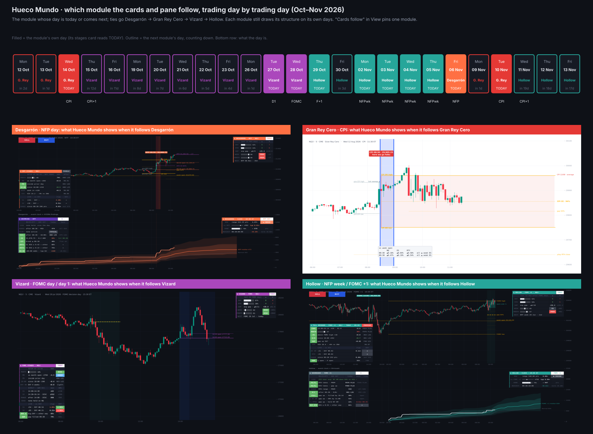
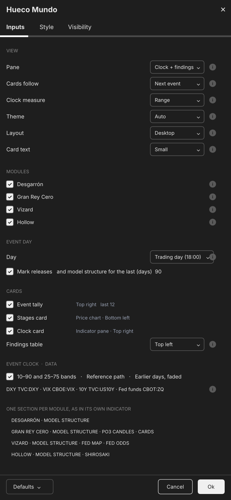

# Hueco Mundo

**Economic-Calendar Models (NFP, CPI, FOMC) for NQ, ES & RTY**

TradingView indicator, Pine Script v6. Open source under the Mozilla Public License 2.0.

*Mock-up of how it looks on the chart.*

**Hueco Mundo** puts my four economic-calendar indicators into one script. Each is imported as a library, the way NWOG / NDOG imports OpenGaps:

- **Desgarrón**: NFP day (Model 6);
- **Gran Rey Cero**: CPI day and the day after (Models 7–8), with the PO3 candles and the VIX / DXY cards;
- **Vizard**: FOMC day and day 1 (Models 9–10), with the Fed card and Fed map;
- **Hollow**: NFP week and the day after FOMC (Models 11–12), with Shirosaki.

Each module is the same code as its own indicator, so the figures, rows and tooltips match. Each can be switched off.

## How it shows four modules

TradingView allows one table per corner, so the cards can't all show at once.

- **Structure on price** (dealing ranges, ATH CE, the FOMC high / low, gap octants, release windows and flags): every module draws its own, on its own days.
- **Cards and indicator pane** (tally, stages card, clock card, event clock and the findings table): these follow one module. By default it is the module whose day is today, or else comes next. On a tie, Desgarrón comes first, then Gran Rey Cero, Vizard and Hollow.
- *Cards follow* in View pins one module instead.

October to November 2026, for example:

- CPI on 14 Oct: Gran Rey Cero;
- 15–28 Oct: Vizard, counting down to FOMC day 1 (27 Oct) and the decision (28 Oct);
- 29 Oct: Hollow, the day after FOMC;
- 2–5 Nov: Hollow, NFP week;
- 6 Nov: Desgarrón, NFP;
- 10 Nov: Gran Rey Cero, CPI.

## Settings

- **View:**
  - Pane: clock + findings, the clock, the findings table, or cards only;
  - Cards follow;
  - Clock measure, Theme (Auto follows the chart), Layout (Desktop or Mobile) and Card text.
- **Modules:** on or off. An off module draws nothing and stops running.
- **Event day, Cards, Event clock and Data** are shared by every module: the tally, stages card, clock card and findings table positions; the DXY, VIX, 10-year and fed funds symbols.
- **One section per module** follows, holding its model-structure, PO3, Fed and findings settings, as in its own indicator.

Two defaults differ from the single indicators, so nothing is drawn twice:

- Gran Rey Cero shades its 08:30–09:00 window on CPI days and the day after;
- Hollow leaves the NFP flag to Desgarrón.

## How to use

- Built for **NQ / MNQ**, **ES / MES** and **RTY / M2K**, on 1 to 15-minute charts. The live stage rows need 30 minutes or less, and the clock 60 minutes or less.
- Make the indicator pane tall enough for the findings table.
- Each module's own description has its data, method and ✓ rule: Desgarrón, Gran Rey Cero, Vizard and Hollow. The figures are pooled across NQ, ES and RTY where those descriptions say so.
- Hueco Mundo runs all four modules on every bar, so it loads slower than one indicator. Switch off what you don't use.

## Limitations

*Historical frequencies, not guarantees.* Without a CBOT data subscription, TradingView delays the fed funds contracts behind Vizard's Fed card and map. In Bar Replay, TradingView may not feed TVC:DXY minute by minute. Nothing here is financial advice.

## Credits

ICT concepts (*Michael J. Huddleston*). Event clock after Kyōka Suigetsu. Written from scratch; open source under MPL 2.0.

## Publishing order on TradingView

Hueco Mundo imports four libraries, kept in `libraries/`. They must exist on TradingView before the indicator compiles.

1. Publish the four libraries from their `.pine` files: `HM_Desgarron`, `HM_GranRey`, `HM_Vizard`, `HM_Hollow` (Pine Editor → open the file → *Publish script* → *Library*).
   - A **public** script can only import **public** libraries. Publish them public if Hueco Mundo will be public.
2. Publish `Hueco_Mundo.pine`.
   - Its imports expect version 1 of each library (`Unclehk2000/HM_Hollow/1`).
   - After you update a library, raise its number in the four import lines at the top.
3. Changes to a module go into its own indicator (Desgarrón, Gran Rey Cero, Vizard, Hollow). The library is regenerated from it and republished as the next version.

## Add it to TradingView

Follow the publishing order above: the four libraries first, then `Hueco_Mundo.pine`.

## More screenshots

## License

Mozilla Public License 2.0, see [LICENSE](LICENSE). © Unclehk2000.

*Historical frequencies, not guarantees. Nothing here is financial advice.*
